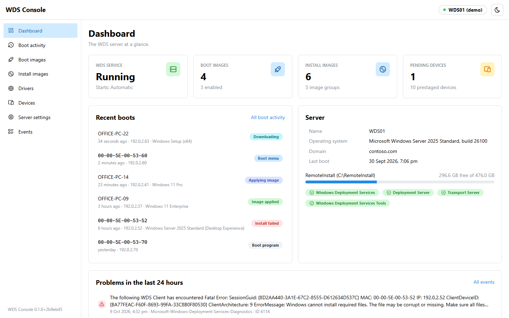
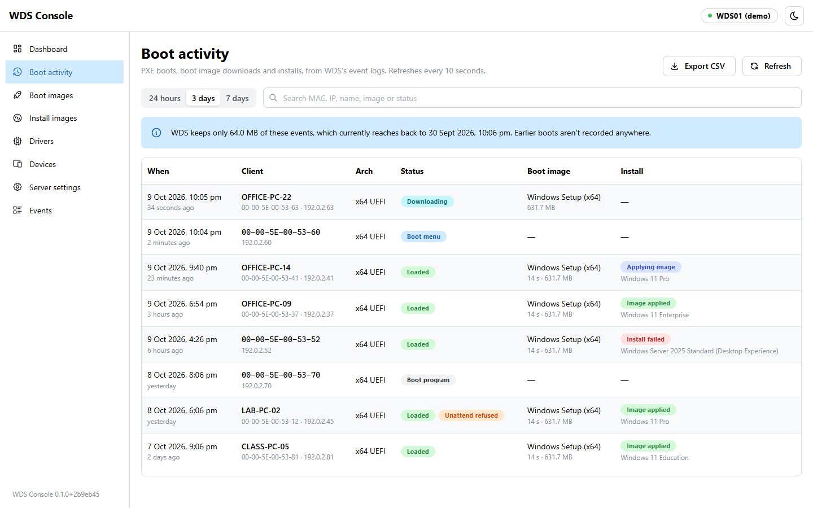
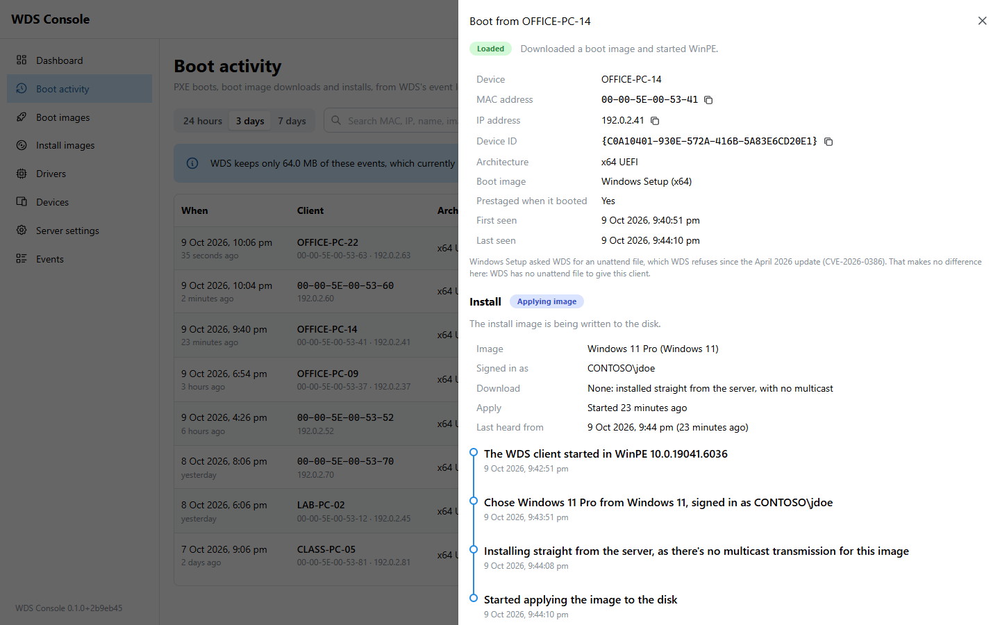
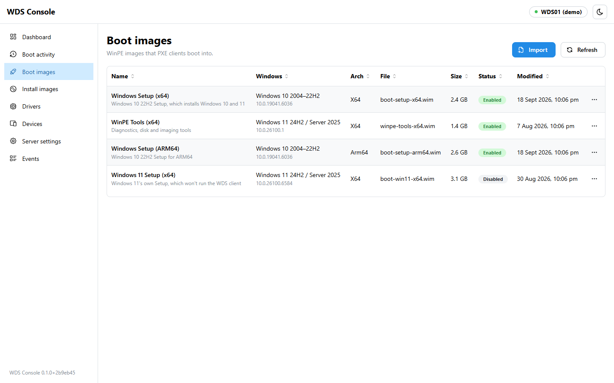
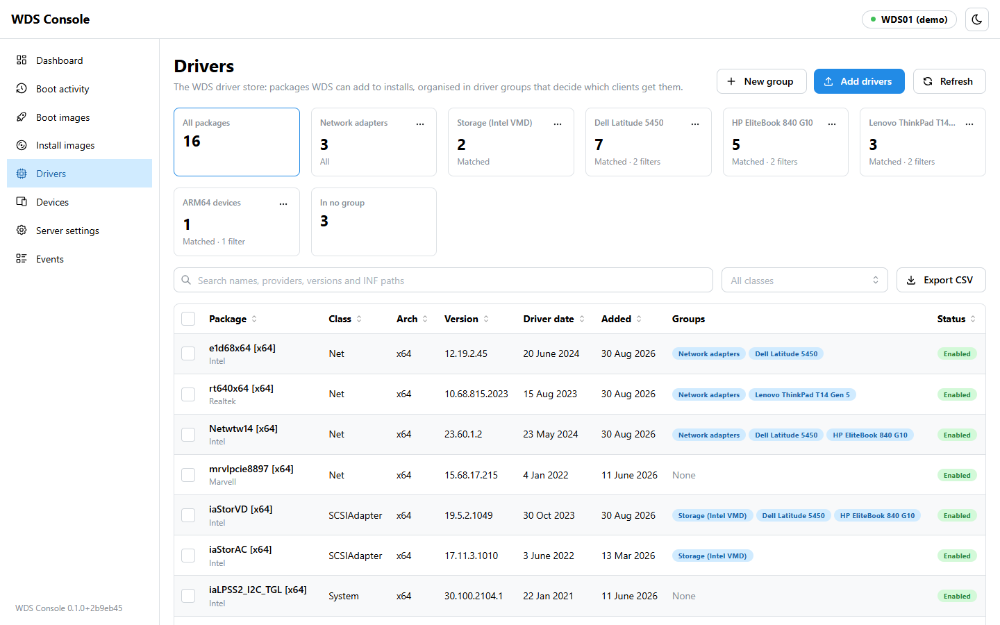
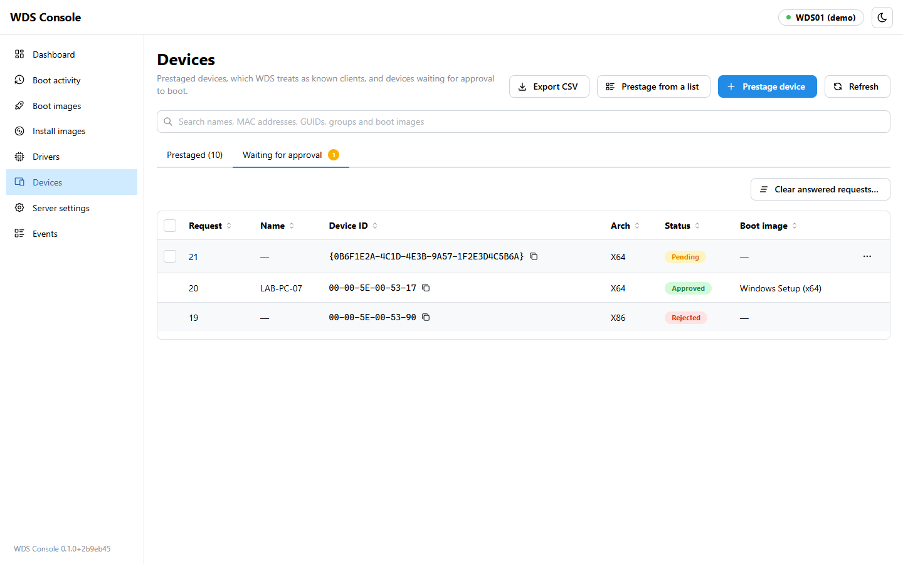
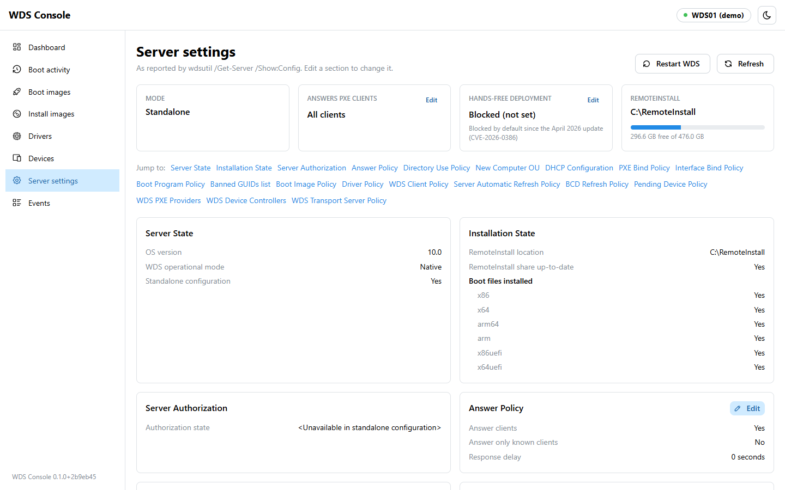

# WDS Console

A web console for **Windows Deployment Services**. Manage boot and install images, devices and server
settings, and watch PXE boots and installs as they happen, from any browser instead of the WDS MMC
snap-in on the server.

<picture>
  <source media="(prefers-color-scheme: dark)" srcset="docs/images/dashboard-dark.png">
  
</picture>

It runs as a Windows service, either on the WDS server itself or on another Windows machine on the
same network, and signs people in with their Windows accounts.

## Features

- **Boot and install images**: import from an upload or from an ISO, WIM or ESD already on the server,
  several editions at a time; enable, disable, rename, reorder and remove images; give install images an
  unattend file. Imports run in the background, and say when they're done from any page.
- **Devices**: prestage devices by MAC address or SMBIOS GUID, one at a time or from a list, each with
  its own boot image, PXE prompt, WDS client unattend file and domain join; approve or reject devices
  waiting for approval, several at once, and clear the answered requests WDS would otherwise keep acting
  on.
- **Boot activity**: every PXE boot, how far it got (the network boot prompt, the boot menu, the boot
  image download) and what it downloaded, and with WDS client logging on, the install that followed:
  which image was chosen, by whom, how long the apply took, and any errors, updated as it goes. Search
  by MAC address, IP, device name or status, and prestage a device straight from one of its boots.
- **Server settings**: PXE response, boot programs and default boot images, the WDS client, pending
  devices, network interfaces, TFTP and multicast, and the hands-free deployment override.
- **Drivers**: add drivers from an uploaded .zip or .cab, or a folder on the server, a driver group at a
  time; create driver groups and choose which clients get them with filters on manufacturer, model,
  chassis type and more; enable, disable, rename, regroup and remove packages, one or many at once;
  and add packages to boot images, for network and storage drivers WinPE lacks.
- **Events**: WDS's event logs, without the routine noise.
- **Day to day**: search, filters and the open item are kept in the page's address, so a link shows a
  colleague the same boot, event or driver group; devices, boots, drivers and events export to CSV;
  enabling, disabling and regrouping can be undone from the message that confirms them; and it works
  on a phone.
- **Access control and audit**: Windows sign-in for the groups and users you choose, and every change
  recorded, with who made it, in the Windows event log.

<table>
  <tr>
    <td width="50%">
      <picture>
        <source media="(prefers-color-scheme: dark)" srcset="docs/images/activity-dark.png">
        
      </picture>
      <b>Boot activity</b>: every PXE boot, what it downloaded, and how far its install got.
    </td>
    <td width="50%">
      <picture>
        <source media="(prefers-color-scheme: dark)" srcset="docs/images/install-detail-dark.png">
        
      </picture>
      <b>Install details</b>: the image chosen and by whom, with a timeline from the WDS client.
    </td>
  </tr>
  <tr>
    <td width="50%">
      <picture>
        <source media="(prefers-color-scheme: dark)" srcset="docs/images/boot-images-dark.png">
        
      </picture>
      <b>Boot images</b>: import, enable, disable, rename, reorder and remove.
    </td>
    <td width="50%">
      <picture>
        <source media="(prefers-color-scheme: dark)" srcset="docs/images/drivers-dark.png">
        
      </picture>
      <b>Drivers</b>: add drivers, group them, and choose which clients get each group.
    </td>
  </tr>
  <tr>
    <td width="50%">
      <picture>
        <source media="(prefers-color-scheme: dark)" srcset="docs/images/devices-dark.png">
        
      </picture>
      <b>Devices</b>: prestage devices, and approve or reject the ones waiting.
    </td>
    <td width="50%">
      <picture>
        <source media="(prefers-color-scheme: dark)" srcset="docs/images/server-settings-dark.png">
        
      </picture>
      <b>Server settings</b>: every WDS policy, editable a section at a time.
    </td>
  </tr>
</table>

These pictures come from the console's demo mode, which shows a made-up WDS server.

## Try it without a WDS server

Demo mode runs the console against a sample WDS server (WDS01 in contoso.com) with images, devices,
drivers and boots at every stage, so you can look around before installing anything. Extract the
release on any 64-bit Windows machine that doesn't have the console installed, and run:

```powershell
.\app\WdsWeb.Api.exe --Wds:Mode=Demo --urls=http://localhost:5080
```

Then browse to `http://localhost:5080`. Nothing in the demo can be changed.

## Requirements

- **The WDS server**: Windows Server with the Windows Deployment Services role, configured (tested on
  Windows Server 2025). Server settings are read from WDSUTIL's output, which is in the server's
  display language; only English is understood so far.
- **Boot images**: Windows 11's own `boot.wim` stops at a deprecation notice instead of running the
  WDS client; use Windows 10's, as [Windows 11 boot images](docs/windows-11-boot-images.md) explains.
- **The machine running the console**: 64-bit Windows 10, 11 or Windows Server. Nothing else to
  install: the release includes the .NET runtime.
- **Remote mode only**: WinRM (TCP 5985) and SMB (TCP 445) from the console's machine to the WDS server,
  and an account that's an administrator on the WDS server.

## Installing

1. Download `WdsWeb-<version>-win-x64.zip` from the releases page. Windows marks downloaded scripts
   as untrusted, so unblock the zip first (right-click → Properties → Unblock, or
   `Unblock-File .\WdsWeb-*.zip`), then extract it.
2. Open **Windows PowerShell as administrator** in the extracted folder.
3. Run the installer.

   On the WDS server:

   ```powershell
   .\Install-WdsWeb.ps1 -AllowedGroups 'CONTOSO\WDS Admins'
   ```

   Or on another Windows machine, managing the WDS server over the network:

   ```powershell
   .\Install-WdsWeb.ps1 -WdsServer wds01 -Credential (Get-Credential CONTOSO\svc-wds) -AllowedGroups 'CONTOSO\WDS Admins'
   ```

4. Browse to `https://<that machine>:8443/` and sign in with a Windows account, such as
   `CONTOSO\jdoe` or `jdoe@contoso.com`.

The installer creates the **WdsWeb** service (running as LocalSystem), a self-signed HTTPS certificate,
a firewall rule for the port, and `C:\ProgramData\WdsWeb\settings.json`. It finishes by checking
that the service can actually manage WDS, and says what's wrong if it can't. Run
`Get-Help .\Install-WdsWeb.ps1 -Full` for every option.

### Who can sign in

Only members of the groups and the users you allow. With none given, that's the local Administrators
group of the machine the console runs on. Give groups, users or both; each run replaces the list:

```powershell
.\Install-WdsWeb.ps1 -AllowedGroups 'CONTOSO\WDS Admins', 'CONTOSO\Helpdesk' -AllowedUsers 'CONTOSO\jdoe'
```

Or edit `Auth` in `C:\ProgramData\WdsWeb\settings.json` and restart the WdsWeb service. Accounts are
checked by the machine the console runs on, so domain accounts work wherever that machine is in the
domain, and local accounts are that machine's own. The console's Server settings page shows who's
allowed, and flags any name Windows can't find.

### Remote mode

The console connects to the WDS server over WinRM, and copies uploads through SMB, as one of:

- **A saved account** (`-Credential`), which must be an administrator on the WDS server. Its password
  is stored in `C:\ProgramData\WdsWeb\credential.json`, encrypted for that machine, readable only by
  SYSTEM and Administrators.
- **The console machine's own account**, without `-Credential`. The service runs as LocalSystem, which
  the WDS server sees as the computer account (for example `CONTOSO\CONSOLE01$`). Add that to the WDS
  server's Administrators group, and no password is stored anywhere.

If the WDS server isn't in the console machine's domain, or you name it by IP address, WinRM also needs
it in the console machine's TrustedHosts list; add `-TrustWdsServer` to do that. Uploads go through
the WDS server's `C$` share; to use another share, see `Wds:StagingShare` in the
[configuration reference](docs/configuration.md).

### Trusting the certificate

Browsers warn about the self-signed certificate until it's trusted. Either trust it on the machines
that use the console (export it from `Cert:\LocalMachine\My`, friendly name "WDS Console", and import
it into Trusted Root Certification Authorities), or give the installer a certificate from your own
certificate authority: `-CertificateThumbprint <thumbprint>` of one in `Cert:\LocalMachine\My`.

### Updating and removing

To update, extract the new release and run its `Install-WdsWeb.ps1` with no parameters: settings are
kept. To remove the console, run `Uninstall-WdsWeb.ps1`; add `-RemoveData` to delete its settings,
keys, saved credential and certificate too. WDS itself is never touched.

## Configuration

Everything site-specific lives in `C:\ProgramData\WdsWeb\settings.json`: which WDS server, who may
sign in, the port and certificate, where uploads are staged and which folders to offer images from.
The installer writes the essentials; [docs/configuration.md](docs/configuration.md) lists every
setting. Settings can also come from environment variables, such as `Auth__AllowedGroups`.

## Security

- The console can do anything a WDS administrator can, so allow only the people who should.
- Sign-in uses Windows: passwords go to Windows, never to a file or a log. Sign-in attempts are rate
  limited, and sessions last eight hours by default.
- Every change is logged with the user who made it, in the Application event log under the source
  "WDS Console". Unattend files are logged by size only, as they often hold passwords.
- The console only serves HTTPS. Its data folder, `C:\ProgramData\WdsWeb`, is readable only by
  SYSTEM and Administrators.
- Hands-free deployment (CVE-2026-0386) stays blocked unless you turn it on in Server settings, which
  warns you first.

## How it works

```
Browser ──HTTPS──▶ WDS Console service ──PowerShell──▶ WDS server: WDS module, WDSUTIL, registry, event logs
```

The service is ASP.NET Core (.NET 10) serving a React frontend. The WDS PowerShell module only runs in
Windows PowerShell 5.1, so the service never calls WDS in-process: it keeps a small pool of 5.1
sessions on the WDS server (a local process in Local mode, WinRM in Remote mode) and runs the scripts
in `src/WdsWeb.Api/Wds/Scripts` there. Each script takes its inputs as parameters, never as text, and
prints one JSON document. Changes made through WDSUTIL are built and validated by the service first.

## Development

You need the .NET 10 SDK, Node.js 22 or later, and a WDS server to point at.

The API reads your WDS server from [user secrets](https://learn.microsoft.com/aspnet/core/security/app-secrets),
so nothing site-specific is committed. To develop on a machine other than the WDS server:

```powershell
# Your WDS server, and an administrator account for it, saved encrypted for your Windows account
dotnet user-secrets set Wds:Mode Remote --project src/WdsWeb.Api
dotnet user-secrets set Wds:ComputerName wds01 --project src/WdsWeb.Api
Get-Credential | Export-Clixml "$env:APPDATA\wds-web\wds01.credential.xml"
dotnet user-secrets set Wds:CredentialFile "%APPDATA%\wds-web\wds01.credential.xml" --project src/WdsWeb.Api

# As administrator, if the server isn't in your domain: let WinRM send it a password
Set-Item WSMan:\localhost\Client\TrustedHosts -Value 'wds01' -Concatenate -Force
```

Then run the API and the frontend dev server:

```powershell
dotnet run --project src/WdsWeb.Api          # http://localhost:5080; sign-in is off in development
npm ci --prefix web
npm run dev --prefix web                      # http://localhost:5173, proxies /api to 5080
```

Use `--launch-profile local` instead to manage WDS on the machine you're on, or `--launch-profile demo`
to work on the frontend against the sample server, with no WDS anywhere.

The README's screenshots come from the demo. To retake them after changing the UI, build the frontend,
start the demo (`dotnet run --project src/WdsWeb.Api --launch-profile demo`) and run
`npm run screenshots --prefix web`, which drives Microsoft Edge headless at 1440×900 in both themes.

Tests: `dotnet test WdsWeb.slnx`. Frontend checks: `npm run build --prefix web` and
`npm run lint --prefix web`.

To build a release package (`artifacts\WdsWeb-<version>-win-x64.zip`), run `.\build\Build-Release.ps1`.
To try it on a test machine, `.\build\Deploy-WdsWeb.ps1 -ComputerName <machine>` builds it, copies it
over WinRM and runs the installer there.
