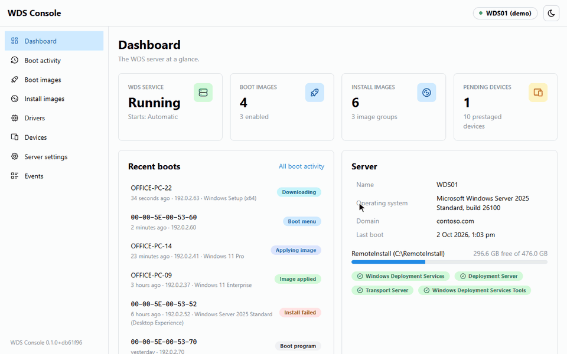

# WDS Console

A web UI for Windows Deployment Services (WDS).

Manage your boot images, install images, devices and drivers from a browser, and watch PCs PXE boot
and install as it happens. No more remoting into the server to use the old MMC snap-in.

<picture>
  <source media="(prefers-color-scheme: dark)" srcset="docs/images/demo-dark.gif">
  
</picture>

## Why I made this

I use WDS to image PCs. The MMC snap-in is showing its age, half the server settings are only in
WDSUTIL, and when a PC won't PXE boot you end up digging through event logs to find out why. I wanted
one place to do all of it, from any PC, so I built it.

If you use it, I'd like to hear how it goes. Issues and feedback are welcome, see
[Feedback and contributing](#feedback-and-contributing).

## What it does

- Import boot and install images. Upload an ISO, WIM or ESD, or use one that's already on the server.
- Prestage devices, one at a time or a whole list from a CSV file.
- Approve or reject devices that are waiting for approval, one or heaps at once.
- See every PXE boot and how far it got. Turn on WDS client logging and you can follow installs live
  too: which image, who picked it, how long it took and what went wrong.
- Manage drivers and driver groups, and add drivers to boot images.
- Change the WDS server settings without touching WDSUTIL.
- Read WDS's event logs without all the noise.
- Export lists to CSV, undo enabling, disabling and regrouping, and use it from your phone.
- Sign in with your Windows account. Every change is logged with who made it.

<table>
  <tr>
    <td width="50%">
      <picture>
        <source media="(prefers-color-scheme: dark)" srcset="docs/images/activity-dark.png">
        
      </picture>
      <b>Boot activity</b>: every PXE boot and how far it got.
    </td>
    <td width="50%">
      <picture>
        <source media="(prefers-color-scheme: dark)" srcset="docs/images/install-detail-dark.png">
        
      </picture>
      <b>Install details</b>: the image, who picked it, and a timeline of the install.
    </td>
  </tr>
  <tr>
    <td width="50%">
      <picture>
        <source media="(prefers-color-scheme: dark)" srcset="docs/images/boot-images-dark.png">
        
      </picture>
      <b>Boot images</b>: import, enable, disable, rename, reorder and remove.
    </td>
    <td width="50%">
      <picture>
        <source media="(prefers-color-scheme: dark)" srcset="docs/images/drivers-dark.png">
        
      </picture>
      <b>Drivers</b>: add drivers, group them and pick which PCs get them.
    </td>
  </tr>
  <tr>
    <td width="50%">
      <picture>
        <source media="(prefers-color-scheme: dark)" srcset="docs/images/devices-dark.png">
        
      </picture>
      <b>Devices</b>: prestage devices, and approve or reject the ones waiting.
    </td>
    <td width="50%">
      <picture>
        <source media="(prefers-color-scheme: dark)" srcset="docs/images/server-settings-dark.png">
        
      </picture>
      <b>Server settings</b>: the WDS server settings, one section at a time.
    </td>
  </tr>
</table>

## Try the demo first

Want a look before you install anything? There's a demo mode with a fake WDS server. It runs on any
64-bit Windows PC, doesn't need WDS, and can't change anything.

1. Download `WdsWeb-<version>-win-x64.zip` from the
   [latest release](https://github.com/leahyandco/wds-web/releases/latest).
2. Right-click the zip, choose **Properties**, tick **Unblock** and click **OK**.
3. Extract it somewhere, like `C:\Temp\WdsWeb`.
4. Open that folder in File Explorer, click the address bar, type `powershell` and press Enter. That
   opens PowerShell in the folder. Then run:

   ```powershell
   .\app\WdsWeb.Api.exe --Wds:Mode=Demo --urls=http://localhost:5080
   ```

5. Open http://localhost:5080 in your browser.

Press Ctrl+C in the PowerShell window when you're done. Don't run the demo on a PC that already has the
console installed, it'll pick up the real settings.

## What you need

- A Windows Server with the WDS role installed and set up. I've tested it on Windows Server 2025.
- The server's display language set to English. The console reads WDSUTIL's output, and it only
  understands English for now.
- An account that's an administrator on the WDS server.
- A boot image that works with WDS. Windows 11's own `boot.wim` doesn't anymore, so use Windows 10's.
  [Windows 11 boot images](docs/windows-11-boot-images.md) explains why and what else you can do.

## Install it

The easiest way is to install it straight on the WDS server. If you'd rather run it on a different
machine, do these steps there and then read [Running it on another machine](#running-it-on-another-machine).

1. Download `WdsWeb-<version>-win-x64.zip` from the
   [latest release](https://github.com/leahyandco/wds-web/releases/latest).
2. Right-click the zip, choose **Properties**, tick **Unblock** and click **OK**. Windows blocks scripts
   that come from the internet, and the installer won't run if you skip this.
3. Extract the zip, for example to `C:\Temp\WdsWeb`.
4. Open the Start menu, type **Windows PowerShell**, right-click it and choose **Run as administrator**.
   It has to be Windows PowerShell, not PowerShell 7.
5. Go to the folder you extracted:

   ```powershell
   cd C:\Temp\WdsWeb
   ```

6. Run the installer:

   ```powershell
   .\Install-WdsWeb.ps1
   ```

   That lets anyone in the server's local Administrators group sign in. To let a domain group in
   instead, add its name:

   ```powershell
   .\Install-WdsWeb.ps1 -AllowedGroups 'YOURDOMAIN\WDS Admins'
   ```

7. When it's done it prints the address, something like `https://wds01:8443/`. Open that in a browser
   on any PC on your network and sign in with your Windows account, either `YOURDOMAIN\you` or
   `you@yourdomain.com`.

Your browser will say the connection isn't private. That's normal, the installer made its own
certificate. See [Getting rid of the certificate warning](#getting-rid-of-the-certificate-warning).

What the installer does: copies the program to `C:\Program Files\WdsWeb`, creates a Windows service
called **WdsWeb**, makes a self-signed HTTPS certificate, opens port 8443 in the firewall and saves its
settings in `C:\ProgramData\WdsWeb\settings.json`. Then it checks the console can actually talk to WDS,
and tells you what's wrong if it can't.

## Who can sign in

Out of the box, only the local Administrators group on the machine the console runs on. To change it,
run the installer again with the groups or users you want. Each run replaces the whole list:

```powershell
.\Install-WdsWeb.ps1 -AllowedGroups 'YOURDOMAIN\WDS Admins', 'YOURDOMAIN\Helpdesk' -AllowedUsers 'YOURDOMAIN\jsmith'
```

## Running it on another machine

You don't have to put it on the WDS server. You can install it on another Windows PC or server and point
it at the WDS server instead. That's called Remote mode. The console then manages WDS over the network,
so WinRM (port 5985) and file sharing (port 445) need to be open from that machine to the WDS server.

Do the same steps as above, but run the installer like this:

```powershell
.\Install-WdsWeb.ps1 -WdsServer wds01 -Credential (Get-Credential YOURDOMAIN\svc-wds) -AllowedGroups 'YOURDOMAIN\WDS Admins'
```

- `-WdsServer` is the name of your WDS server.
- `-Credential` is an account that's an administrator on the WDS server. It'll ask for the password,
  and saves it encrypted on this machine, where only SYSTEM and Administrators can read it.

Rather not store a password? Leave out `-Credential`. The console then connects as the machine's own
computer account (like `YOURDOMAIN\CONSOLE01$`), so add that to the WDS server's local Administrators
group.

If the WDS server isn't on the same domain, or you're using its IP address instead of its name, add
`-TrustWdsServer` as well.

If you're running it on Windows 10 or 11 and get "running scripts is disabled on this system", see
[Something not working?](#something-not-working)

## Getting rid of the certificate warning

You've got two options:

- **Trust the certificate the installer made.** On the machine running the console, open
  **Manage computer certificates** from the Start menu, go to **Personal > Certificates**, right-click
  the one with the friendly name **WDS Console** and choose **All Tasks > Export**. Don't export the
  private key. Then on each PC that uses the console, double-click the exported file, choose
  **Install Certificate > Local Machine** and put it in **Trusted Root Certification Authorities**. With
  a lot of PCs, push it out with Group Policy instead.
- **Use your own certificate.** If you've got one from your own certificate authority in the machine's
  **Personal** store, run the installer again with its thumbprint:

  ```powershell
  .\Install-WdsWeb.ps1 -CertificateThumbprint <thumbprint>
  ```

## Updating

1. Download the new release, unblock it and extract it, same as when you installed it.
2. Wait for any image imports to finish, as updating restarts the console and cancels them.
3. In Windows PowerShell as administrator, go to the new folder and run `.\Install-WdsWeb.ps1` with
   nothing after it.

Your settings are kept.

## Uninstalling

From the extracted folder, in Windows PowerShell as administrator:

```powershell
.\Uninstall-WdsWeb.ps1
```

That removes the service and the program but keeps your settings, in case you reinstall. To remove the
lot, including the settings, any saved password and the certificate:

```powershell
.\Uninstall-WdsWeb.ps1 -RemoveData
```

Neither one touches WDS, your images or your WDS settings.

## Something not working?

- **"running scripts is disabled on this system".** Run this in the same PowerShell window, then try
  again. It only affects that window:

  ```powershell
  Set-ExecutionPolicy -Scope Process -ExecutionPolicy Bypass
  ```

- **"is not digitally signed" or "cannot be loaded".** You didn't unblock the zip. Unblock it and
  extract it again, or run `Get-ChildItem -Recurse | Unblock-File` in the extracted folder.
- **It complains about PowerShell editions or "#requires".** You're in PowerShell 7. Open
  **Windows PowerShell** instead.
- **"Windows Deployment Services isn't installed on this machine".** You're not on the WDS server. Run
  it there, or use [Remote mode](#running-it-on-another-machine).
- **Other PCs can't open the page.** The firewall rule only covers domain and private networks, so
  check the machine's network isn't set to Public.
- **You can't sign in.** Your account isn't allowed. Run the installer again with your group or user
  in `-AllowedGroups` or `-AllowedUsers`.
- **A PC boots, then Windows Setup says WDS is "partly deprecated".** That's Windows 11's boot image.
  Use Windows 10's, see [Windows 11 boot images](docs/windows-11-boot-images.md).
- **Anything else.** Look in the Application event log on the machine running the console, under the
  source **WDS Console**. If you're still stuck,
  [open an issue](https://github.com/leahyandco/wds-web/issues).

## Settings

Everything lives in `C:\ProgramData\WdsWeb\settings.json`: which WDS server, who can sign in, the port,
the certificate, where uploads go and which folders you can import images from. The installer sets the
basics, and [docs/configuration.md](docs/configuration.md) explains every setting. Restart the
**WdsWeb** service after you change it.

## Security

- Anyone who can sign in can do anything a WDS admin can, so be picky about who you let in.
- Passwords go straight to Windows. They're never saved or logged. Sign-in attempts are rate limited,
  and you're signed out after eight hours.
- Every change is logged in the Application event log, under the source **WDS Console**, with who made
  it. Unattend files are only logged by size, because they often have passwords in them.
- It's HTTPS only, and `C:\ProgramData\WdsWeb` can only be read by SYSTEM and Administrators.
- Hands-free deployment (CVE-2026-0386) stays off unless you turn it on in Server settings, and it warns
  you first.

Found a security hole? Please don't open a public issue.
[Report it privately](https://github.com/leahyandco/wds-web/security/advisories/new) instead.

## For developers

### How it works

The backend is ASP.NET Core (.NET 10) and the front end is React. The WDS PowerShell module only works
in Windows PowerShell 5.1, so the service doesn't load it directly. It keeps a few 5.1 sessions open on
the WDS server (a local process in Local mode, WinRM in Remote mode) and runs the scripts in
`src/WdsWeb.Api/Wds/Scripts` through them. Scripts get their inputs as parameters, never pasted into the
script text, and each one prints a single JSON result. Anything that goes through WDSUTIL is built and
checked by the service first.

### Running it from source

You need the .NET 10 SDK, Node.js 22 or later, and a WDS server to point it at.

Your WDS server's details go in [user secrets](https://learn.microsoft.com/aspnet/core/security/app-secrets),
so nothing about your setup ends up in the repo:

```powershell
# Your WDS server, and an administrator account for it, saved encrypted for your Windows account
dotnet user-secrets set Wds:Mode Remote --project src/WdsWeb.Api
dotnet user-secrets set Wds:ComputerName wds01 --project src/WdsWeb.Api
Get-Credential | Export-Clixml "$env:APPDATA\wds-web\wds01.credential.xml"
dotnet user-secrets set Wds:CredentialFile "%APPDATA%\wds-web\wds01.credential.xml" --project src/WdsWeb.Api

# As administrator, if the server isn't on your domain: let WinRM send it a password
Set-Item WSMan:\localhost\Client\TrustedHosts -Value 'wds01' -Concatenate -Force
```

Then start the API and the front end:

```powershell
dotnet run --project src/WdsWeb.Api          # http://localhost:5080, sign-in is off in development
npm ci --prefix web
npm run dev --prefix web                      # http://localhost:5173, sends /api to 5080
```

Use `--launch-profile local` to manage WDS on the machine you're on, or `--launch-profile demo` to work
against the fake server with no WDS at all.

### Tests, screenshots and releases

- Tests: `dotnet test WdsWeb.slnx`. Front end checks: `npm run build --prefix web` and
  `npm run lint --prefix web`.
- Screenshots come from the demo. Build the front end, start the demo
  (`dotnet run --project src/WdsWeb.Api --launch-profile demo`) and run `npm run screenshots --prefix web`.
  It uses Microsoft Edge to take them at 1440x900, in light and dark.
- `.\build\Build-Release.ps1` builds the release zip into `artifacts`.
  `.\build\Deploy-WdsWeb.ps1 -ComputerName <machine>` builds it, copies it to a test machine over WinRM
  and runs the installer there.
- To publish a release, bump `<Version>` in `Directory.Build.props` and push a matching tag, like
  `v0.1.1`. GitHub Actions builds the zip and publishes the release.

## Feedback and contributing

Issues and feedback are welcome. If something's broken, confusing or missing, or you've got an idea,
[open an issue](https://github.com/leahyandco/wds-web/issues/new/choose) and let me know. Questions,
and how you're using it, go in [Discussions](https://github.com/leahyandco/wds-web/discussions).

Pull requests are welcome too. If it's something big, open an issue first so we can talk about it.

## Licence

MIT. See [LICENSE](LICENSE).

Maintained by [Leahy & Co](https://leahyandco.com.au/?utm_source=github). Want it set up, or need a
feature added? I take on paid work.
